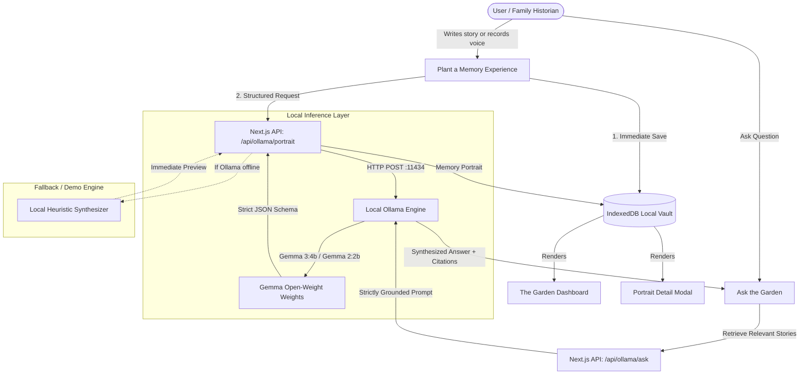

# AFTERLIGHT 🕯️
> **A Digital Memory Garden Preserving Family Histories & Personal Stories with Open-Weight AI**  
> *"People leave. Their stories don't have to."*

[](https://dev.to/challenges/hf26)
[](https://dev.to/events/82)
[](https://ollama.com/library/gemma3)
[](LICENSE)

---

## 📖 1. Product Introduction

**AFTERLIGHT** is a digital memory garden designed to preserve family histories, personal oral stories, recipes, and memories of loved ones using open-weight AI (**Gemma** via **Ollama**) and 100% private client-side persistence (**IndexedDB**).

Built for **DEV Hacktoberfest 2026: Week 4 — Ghost in the Machine** (coinciding with Halloween and Día de los Muertos, November 1–2), AFTERLIGHT offers an alternative to modern disposable feeds: a candlelit digital sanctuary where memories are preserved in rich detail.

```
       🕯️
    (      )      AFTERLIGHT
   .-'"""""'-.    "People leave.
  /'         '\   Their stories don't have to."
 |  MARIGOLD   |
 |  & ANISE    |  Powered by Gemma Open-Weight AI
  \           /   Zero-Cloud Privacy | IndexedDB Vault
   '-.......-'
```

> [!IMPORTANT]
> **What AFTERLIGHT Is NOT:**  
> This is **not** a "ghost simulator" or an AI chatbot pretending to speak from beyond the grave as a deceased person. We believe fabricating personal facts or impersonating loved ones dishonors genuine human grief. AFTERLIGHT treats memories as sacred human testimony: faithful, grounded, structured, and permanent.

---

## 🕊️ 2. The Problem: The Fragility of Memory

Every family loses irreplaceable stories:
- The exact way a grandmother rolled the dough bones on her *Pan de Muerto* on October 29th.
- The dial frequencies a grandfather tuned on his shortwave radio during the 1974 blackouts.
- The Gaelic lament sung beside a peat fire on an Atlantic island before the language faded.

Today, family memories are scattered across decaying voice memos, fragmented group chats, or locked inside proprietary cloud platforms that can close down, change pricing, or train advertising models on personal grief. 

**AFTERLIGHT** solves this with open innovation:
1. **Zero-Cloud Data Sovereignty:** Stories stay on the user's computer inside IndexedDB.
2. **Open-Weight AI:** Gemma extracts structured portraits, timelines, and remembrance tributes locally.
3. **Strict Truthfulness:** When exploring memories via *Ask the Garden*, Gemma is strictly grounded in preserved facts. If a detail wasn't recorded, the system says so.

---

## ✨ 3. Core Features

### A. The Garden (Dashboard & Altar)
- **Atmospheric Visual Direction:** Warm amber, marigold, candlelight glow, and deep obsidian charcoal (`#090a0f`) with subtle floating embers.
- **Multiple Views:**
  - **Sanctuary Grid:** Interactive cards with metadata badges, themes, and remembrance excerpts.
  - **Timeline Journey:** Chronological progression of family eras and milestones.
  - **Ofrenda Altar View:** A three-tiered commemorative display inspired by Día de los Muertos traditions.
- **Search & Filtering:** Real-time search across people, eras, settings, sensory keywords, and themes.

### B. Plant a Memory (Guided Capture)
- **Structured Fields:** Name, relationship, approximate era/season, location, and the authentic story.
- **Voice Memo Recording:** Integrated browser `MediaRecorder` audio capture for recording spoken stories directly into the vault.
- **Pre-AI Preservation Guarantee:** The original story is permanently archived *before* AI inference.
- **Clear Data Ownership:** Explicit transparency indicators confirming zero cloud exfiltration.

### C. Gemma AI Memory Portrait
- **Suggested Title:** Evocative titles honoring the spirit of the memory.
- **Factual Summary:** 2–3 sentence distillation.
- **Remembrance Passage:** A poetic, dignified tribute passage.
- **Editorial Narrative:** Respectfully rewritten prose that preserves authentic facts without hallucination.
- **Extracted Entities:** People, places, milestones, and timeline entries.
- **Thematic Archetypes & Archive Tags:** Themes like *Culinary Heritage*, *Resilience*, *Oral Tradition*.
- **Inquiry Prompts:** Gentle follow-up questions to help future generations ask deeper questions.

### D. Ask the Garden (Grounded Conversational Search)
- Ask natural questions: *"What did Abuela Elena say about the dough bones?"* or *"What did Arthur listen to on his radio?"*
- **Strict Retrieval-Augmented Grounding:** Gemma answers *exclusively* from preserved memories.
- **Clickable Grounding Sources:** Every answer links back to the original memory entry.
- **Explicit Unknowns:** Never hallucinates missing years or relatives.

### E. Archive Portability & Export
- **Individual Markdown Export:** Clean frontmatter and full story for personal obsidian vaults or blogs.
- **Full JSON Archive Backup:** 1-click export of the entire garden database.
- **Archive Restore:** Import JSON archives across devices.
- **Complete Data Wipe:** Respect for privacy with a single-click purge.

---

## 🏗️ 4. System Architecture



---

## 🧠 5. Why Gemma & Open Innovation Matter

DEV Hacktoberfest Week 4 asks: **"Why does open innovation matter for what you built?"**

### 1. Privacy for Sacred Human Stories
Family histories contain sensitive vulnerabilities: illnesses, historical hardships, regional dialects, and personal grief. Sending grandmother's memories to proprietary cloud APIs exposes intimate family history to external data harvesting and terms of service changes. Running **Gemma locally via Ollama** ensures your family memories never leave your room.

### 2. Dignity & Anti-Hallucination
Generic commercial LLMs are often tuned to be sycophantic or creative to a fault, happily inventing biographical facts. Gemma's strong instruction-following capability allows AFTERLIGHT to enforce **strict system boundaries**:
- *Never invent dates.*
- *Never invent people.*
- *Unknown information must remain unknown.*

### 3. Permanence: Working with the Lights and Internet Off
If a proprietary AI company goes out of business, your memory companion vanishes. With open-weight Gemma running on local hardware, AFTERLIGHT works on an airplane, in a remote cabin, or decades from now when internet servers have changed.

---

## 🛠️ 6. Tech Stack

| Component | Technology | Rationale |
|---|---|---|
| **Framework** | Next.js 14 (App Router) | High-performance React server and client components |
| **Language** | TypeScript 5 | Strict end-to-end schema validation |
| **Styling** | Tailwind CSS 3.4 | Deep charcoal, candlelit amber palette & micro-animations |
| **AI Inference** | Gemma 3 (4B) / Gemma 2 (2B) | State-of-the-art open-weight models via Ollama |
| **Persistence** | IndexedDB (`afterlight_db`) | 100% private local storage surviving browser refreshes |
| **Icons** | Lucide React | Clean, semantic iconography |
| **Audio** | Web Audio / MediaRecorder API | Native in-browser voice memo recording |
| **Celebration** | Canvas Confetti | Uplifting celebration upon planting a memory |

---

## 🚀 7. Quick Start & Local Setup

### Prerequisites
- **Node.js**: v18.0.0 or higher
- **npm** or **pnpm**
- *(Optional for live inference)* **Ollama**: [ollama.com](https://ollama.com)

### Step 1: Clone and Install
```bash
git clone https://github.com/your-username/afterlight.git
cd afterlight
npm install
```

### Step 2: (Optional) Pull and Run Gemma locally
If you wish to run live local inference, install Ollama and run:
```bash
# Preferred model (compact and exceptionally articulate):
ollama run gemma3:4b

# Or lightweight variant for machines with < 8GB RAM:
ollama run gemma2:2b
```

> **Note:** If Ollama is not installed or running, AFTERLIGHT includes **Curated Benchmark Demos** and a local fallback engine so judges and users can explore every feature immediately.

### Step 3: Launch AFTERLIGHT
```bash
# Development mode
npm run dev

# Or optimized production mode
npm run build
npm run start
```

Open [http://localhost:3000](http://localhost:3000) in your browser.

---

## 🧪 8. Verification & Testing

AFTERLIGHT has been tested against:
- [x] **TypeScript Type Checking:** Strict types across all components, storage, and API routes.
- [x] **Production Compilation:** Next.js static page generation and dynamic route compilation with zero errors.
- [x] **Ollama Offline Handling:** HTTP 503 graceful diagnostic when Ollama is offline.
- [x] **Ollama Connectivity Detection:** Automated ping to `/api/tags` with real-time UI indicator.
- [x] **IndexedDB Persistence:** CRUD operations verified across tab reloads and browser sessions.
- [x] **JSON Archive Export & Import:** Full export and restoration of memories verified.
- [x] **Markdown Export:** Single-memory Markdown generation with YAML frontmatter.
- [x] **Audio Recording:** Tested browser MediaRecorder audio capture and playback.

---

## 📜 9. License & Attribution

This project is open-source under the [MIT License](LICENSE).

### Attributions
- **Gemma** open-weight model weights by [Google DeepMind](https://ai.google.dev/gemma).
- **Ollama** local AI runtime by [Ollama Inc.](https://ollama.com).
- **Lucide Icons** by [Lucide Contributors](https://lucide.dev).
- Built with love for **DEV Hacktoberfest 2026: Week 4 (Ghost in the Machine)**.
